# Manual de PostHarvestPro 1.0.0

**Fisiología y tecnología poscosecha, calidad, vida de anaquel y evaluación sensorial en el navegador**

Luis Ángel Barrera-Guzmán · LABG Suite · 2026 · Software libre GPL-3.0

---

## Introducción

### I.1 Qué es PostHarvestPro

PostHarvestPro reúne en una sola aplicación los cálculos que acompañan a un producto hortofrutícola desde la cosecha hasta el consumidor:

- los índices de **calidad y madurez** y el **color**;
- la **cinética del deterioro** y la **vida de anaquel**, a una temperatura o a cualquiera, incluido el tiempo hasta el rechazo con datos censurados;
- la **respiración**, el **etileno** y el diseño de **atmósferas modificadas**, con el preenfriamiento y su carga térmica;
- las **pérdidas** en la cadena de valor y el **daño mecánico**;
- la **evaluación sensorial** discriminativa, afectiva y descriptiva, con el diseño de las catas;
- el análisis de **ensayos** poscosecha (factoriales y medidas repetidas);
- las calculadoras de **empaque y logística**;
- un **informe** autocontenido y un **archivo de proyecto** para seguir después.

Cada resultado se acompaña de una lectura en palabras y de la cita del método. Cada motor de cálculo se comparó con una implementación independiente (apartado I.6).

La aplicación está hecha sólo con HTML, CSS y JavaScript. No hay servidor, cuentas ni servicios de pago, y no carga bibliotecas de terceros. Todos los cálculos ocurren en tu navegador: **tus datos no salen de tu computadora**.

### I.2 Cómo abrirla

- **En línea:** <https://luisangelbg.github.io/PostHarvestPro/>. Funciona en cualquier navegador moderno, también en tabletas y teléfonos.
- **Sin conexión, con doble clic:** descarga el repositorio, descomprímelo y abre `index.html`. Los datos de ejemplo vienen dentro del programa, así que todo funciona sin servidor.
- **Con un servidor local (opcional):** `Open PostHarvestPro.bat` (Windows) o `powershell -ExecutionPolicy Bypass -File server.ps1` lo sirven en `http://localhost:9970`. Si lo ejecutas como administrador, también lo verás desde una tableta conectada a la misma red.

### I.3 Tus datos

Cada herramienta que analiza una tabla tiene la misma entrada de datos:

1. **Cargar ejemplo:** abre un conjunto simulado, con su descripción (apartado I.5).
2. **Abrir archivo:** CSV, TSV o TXT (separados por coma, punto y coma o tabulador; con punto y coma o tabulador se entiende la coma decimal), XLSX, XLSM u ODS. Si el libro tiene varias hojas, aparece un selector.
3. **Pegar una tabla:** copia las celdas de tu hoja de cálculo, con los nombres de las columnas en la primera fila, y pégalas.
4. **Elegir las columnas:** la app propone la columna de cada papel (tiempo, grupo, atributo…) por su nombre. Revisa la propuesta y cámbiala si hace falta. Los papeles opcionales pueden quedar vacíos.

Las tablas deben venir **en formato largo**: una fila por unidad observada (fruto, frasco, consumidor por producto…) y una columna por variable. Las celdas vacías, `NA` o `—` se toman como faltantes.

En las tablas editables (etapas de la cadena, clases de calibre, películas, productos…) se escribe directamente. **+ Agregar fila** añade una línea y **×** la quita.

### I.4 La interfaz común de la LABG Suite

- **Barra superior:** el enlace a la LABG Suite, el idioma (ES | EN), el tema claro u oscuro, las animaciones, «Reportar un problema» y la ayuda (**?**), que muestra los atajos de teclado.
- **Barra de bloques:** los nueve bloques de la app. Un bloque en el que ya trabajaste y que tiene resultados muestra una palomita. **Alt + →** y **Alt + ←** pasan al bloque siguiente o al anterior.
- **Navegador:** a la izquierda, los bloques; a la derecha, el índice del bloque abierto con sus herramientas (pestañas) y secciones. Tiene dos modos: **Documento**, con todas las secciones, y **Enfocado**, una sección a la vez. **Ctrl + K** abre una paleta para buscar cualquier herramienta, sección o control.
- **Pestañas de herramientas:** cada bloque reparte sus herramientas en pestañas. La app recuerda la última que abriste en cada bloque.
- **Figuras:** cada figura tiene dos botones rápidos:
  - **⤓** descarga un SVG con los colores del tema claro;
  - el **ícono de imagen** descarga un PNG de 170 mm de ancho a 300 ppp, con su resolución escrita en el archivo.
  
  Con el **Estudio de figuras** de la suite la figura se abre a pantalla dividida para ajustar tamaño, letras, paleta y leyenda, y exportarla a PNG, SVG, PDF o TIFF a 300, 600 o 1200 ppp. El **editor ✎** cambia textos, ejes y series de una figura.
- **Tablas de resultados:** se descargan en CSV o XLSX.
- **Esperas:** los cálculos largos muestran una animación propia (un fruto que madura mientras se dibuja su curva de firmeza).

### I.5 Datos de ejemplo

Los diez conjuntos de ejemplo son **simulados**: se generaron con modelos y parámetros del orden de los publicados para cada cultivo (`tools/generar_datos.R`, semilla 20261004). **No son mediciones**: sirven para aprender la app y para ver que cada análisis responde como se espera. Están en `data/` como CSV y dentro del programa.

| Archivo | Contenido | Dónde se usa |
|---|---|---|
| `mango_temperaturas.csv` | Mango «Ataulfo» a 13, 20 y 25 °C; 4 frutos por temperatura y día: firmeza, L*a*b*, SST, AT, pH, pérdida de peso, antracnosis | Bloques 2, 3 y 7 |
| `chayote_rechazo.csv` | Chayote con dos recubrimientos y testigo: días hasta el rechazo, censura a los 35 días | Bloque 3 |
| `chayote_peso.csv` | Pérdida de peso de 6 frutos marcados por tratamiento cada 5 días | Bloque 7 |
| `aguacate_estatico.csv` | Aguacate «Hass», 3 frascos a 20 °C: CO₂, O₂ y etileno cada 30 min | Bloque 4 |
| `aguacate_climaterico.csv` | Respiración y etileno diarios durante 12 días | Bloque 4 |
| `jitomate_cadena.csv` | Seis etapas de una cadena de jitomate: pérdida y precio | Bloque 5 |
| `jitomate_caidas.csv` | Caídas de 10 a 60 cm: área y volumen del daño, incidencia | Bloque 5 |
| `cafe_discriminativas.csv` | Triangular, dúo-trío y 2-AFC entre dos cafés | Bloque 6 |
| `cafe_consumidores.csv` | 80 consumidores × 4 cafés: agrado, punto justo y CATA | Bloque 6 |
| `cafe_descriptivo.csv` | 8 jueces × 4 cafés × 2 sesiones × 7 atributos | Bloque 6 |

### I.6 Validación

Los motores de cálculo se compararon con implementaciones independientes de referencia, con tablas publicadas y con cálculos a mano: **431 pruebas y 71 042 comparaciones, sin fallas**. Cada prueba lleva escrita su tolerancia.

Las pruebas corren en el navegador con `tests/run.html` (también con doble clic) o en la consola con `node tests/run-node.js`. Los guiones de R, las referencias y un informe por área están en `tests/validacion/`. Allí se documentan también los errores que la comparación atrapó y cómo se corrigieron.

---

## 1. Inicio

La portada resume la app. Contiene:

- una ilustración animada: la firmeza de tres lotes almacenados a 13, 20 y 25 °C y su límite comercial;
- la ruta de trabajo y las tarjetas de los nueve bloques;
- la **galería de datos de ejemplo**: cada botón abre la herramienta con el ejemplo cargado;
- la lista de **métodos con sus fuentes** y una sección de **teoría en breve** (madurez, climaterio, cinética, temperatura, vida de anaquel, atmósferas, agua, pérdidas y evaluación sensorial);
- lo que la app no hace, las referencias completas y cómo citarla.

**Empezar con un ejemplo** abre el resumen de calidad del Bloque 2 con los datos del mango.

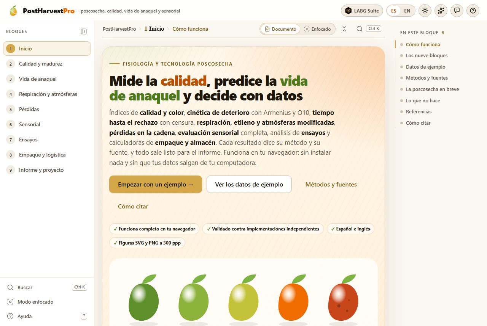

---

## 2. Calidad y madurez

### 2.1 Resumen de calidad

**Datos.** Una fila por fruto o muestra. Los papeles opcionales son:

- **grupo** (temperatura, tratamiento, lote) y **tiempo**;
- **sólidos solubles** y **acidez titulable**, con los que se calculan SST/AT y BrimA;
- **L\*, a\* y b\***, con los que se calculan croma, tono, índice de color de cítricos e índice de pardeamiento.

En **Atributos para resumir** se marcan las demás variables.

**Resultados:**

- la tabla por grupo y tiempo con media ± DE, media ± EE o media e IC del 95 %;
- la evolución de la variable elegida (media ± EE por grupo);
- una lectura del cambio entre el primer y el último tiempo de cada grupo.

**Ejemplo (mango).** La firmeza baja de 116 a 32 N en 21 días a 13 °C, pero de 122 a 4.8 N en 12 días a 25 °C. Para saber si las diferencias son reales, el ensayo se analiza en el Bloque 7; para modelar la velocidad, en el Bloque 3.

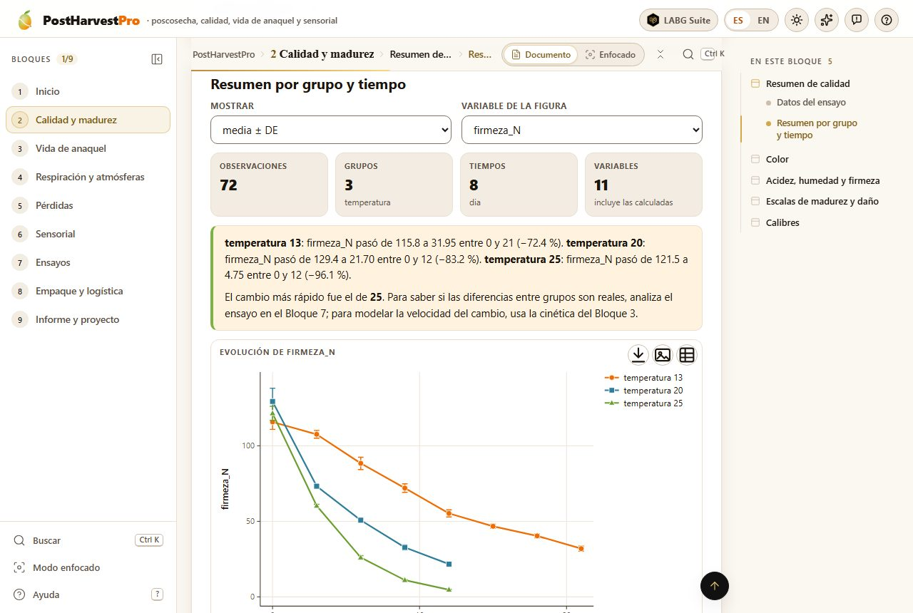

**Índices:**

- SST/AT = sólidos solubles / acidez titulable;
- BrimA = SST − k·AT, con k = 2 por omisión (Jordan et al. 2001), porque la lengua percibe la acidez con más peso que el azúcar.

### 2.2 Color

- **Conversor.** Escribe un color en L\*a\*b\* (iluminante D65, observador de 2°), en RGB o en hexadecimal; las otras formas se actualizan y aparece la muestra. Si el color cae fuera de la gama de una pantalla, se muestra el más cercano con el mismo L\* y h°. Se calculan:
  - el croma C\* = √(a\*² + b\*²) y el ángulo de tono h° = atan2(b\*, a\*), entre 0 y 360°;
  - el índice de color de cítricos CCI = 1000·a\*/(L\*·b\*);
  - el índice de pardeamiento BI = 100(x − 0.31)/0.17;
  - los índices de blancura, de amarillez y de color del jitomate.
- **Diferencia entre dos colores:** ΔE\*ab (1976), ΔE94 y ΔE00 (CIEDE2000), con su lectura orientativa (menos de 1, imperceptible; de 2 a 3.5, perceptible para cualquiera; más de 5, colores distintos). Conviene reportar ΔE00: corrige las distorsiones de ΔE\*ab en los azules, los grises y los colores muy saturados.
- **El color de tus datos:** con columnas L\*, a\* y b\*, la app muestra el color medio de cada grupo en cada tiempo, su ΔE00 respecto al color inicial del grupo y el tono a lo largo del tiempo.

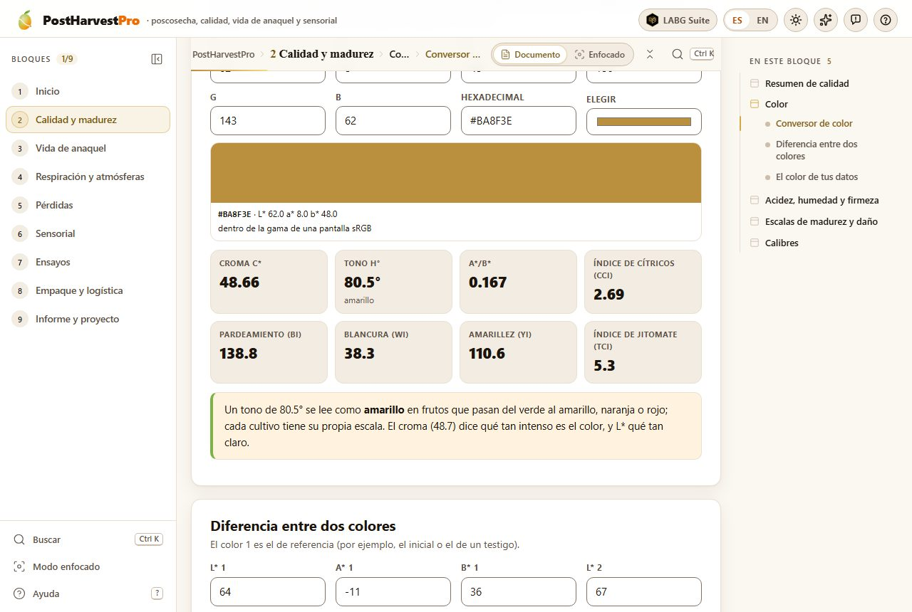

### 2.3 Acidez, humedad y firmeza

Son calculadoras directas:

- **Acidez titulable** (AOAC 942.15): %ácido = V·N·meq·(volumen aforado/alícuota)·100 / muestra. Hay seis ácidos dominantes: cítrico 0.064, málico 0.067, tartárico 0.075, oxálico 0.045, láctico 0.090 y acético 0.060 g/meq. La misma acidez se expresa también como los otros ácidos.
- **Humedad** en base húmeda y seca y **materia seca**, a partir de las pesadas de la cápsula.
- **Firmeza** en N, kgf, lbf y gf, y la presión sobre el émbolo en kPa.
- **Pérdida de peso** y su tasa diaria.

### 2.4 Escalas de madurez y daño

1. Define la escala (o elige una plantilla: daño 0–4, madurez 1–5, pudrición 0–3) y la **tolerancia comercial**, es decir, la clase más alta que se acepta.
2. Da una calificación por fruto, con grupo y tiempo opcionales, o escribe los conteos por lote («Lote A: 50, 20, 15, 10, 5»).

Resultados por grupo:

- el **índice ponderado** de McKinney (1923): 100·Σ(clase·frecuencia)/(N·clase máxima);
- el grado medio;
- la **incidencia**: porcentaje fuera de la clase más baja;
- la **fruta comercializable**: porcentaje hasta la tolerancia;
- la distribución por clase en barras apiladas y, con tiempo, la evolución del índice.

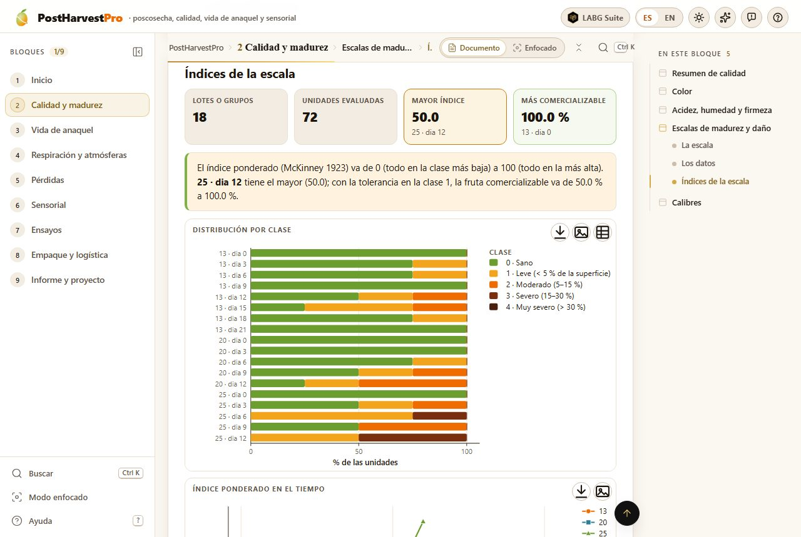

### 2.5 Calibres

Las clases se editan con nombre, mínimo y máximo. Hay plantillas por peso, por diámetro y por número de frutos en una caja de 4 kg; en esta última, los límites son los puntos medios entre cuentas vecinas. La app cuenta los frutos de cada clase, con porcentaje, media y clase modal, por grupo si lo hay, y señala los frutos que no caen en ninguna clase.

---

## 3. Cinética y vida de anaquel

### 3.1 Modelos cinéticos

**Datos.** Tiempo, atributo y grupo opcional (por ejemplo, la temperatura).

Para cada grupo se ajustan los tres órdenes de reacción por **mínimos cuadrados no lineales en la escala original**:

| Orden | Modelo | Vida media |
|---|---|---|
| 0 | C = C₀ − k·t | C₀/(2k) |
| 1 | C = C₀·e^(−k·t) | ln 2 / k |
| 2 | 1/C = 1/C₀ + k·t | 1/(C₀·k) |

- La app elige el orden con el **AIC** más bajo; puedes fijarlo tú.
- La tabla de los tres órdenes muestra ΔAIC, los pesos de Akaike y, como referencia clásica, el R² de las rectas linealizadas.
- k > 0 indica que el atributo baja; k < 0, que sube (por ejemplo, el pardeamiento).
- Los intervalos son de Wald con la t de Student.

Con un **límite de aceptación** se calcula el **tiempo para alcanzarlo** con su intervalo por el método delta. Para un orden 1, por ejemplo, t = ln(C₀/L)/k.

**Ejemplo (mango, firmeza).** El primer orden gana en las tres temperaturas.

| Temperatura | k (d⁻¹) | Vida media (días) | Tiempo a 25 N (días) |
|---|---|---|---|
| 13 °C | 0.061 | 11.3 | 25.9 [24.0, 27.8] |
| 20 °C | 0.157 | 4.4 | 10.4 [9.2, 11.5] |
| 25 °C | 0.251 | 2.8 | 6.3 [5.9, 6.8] |

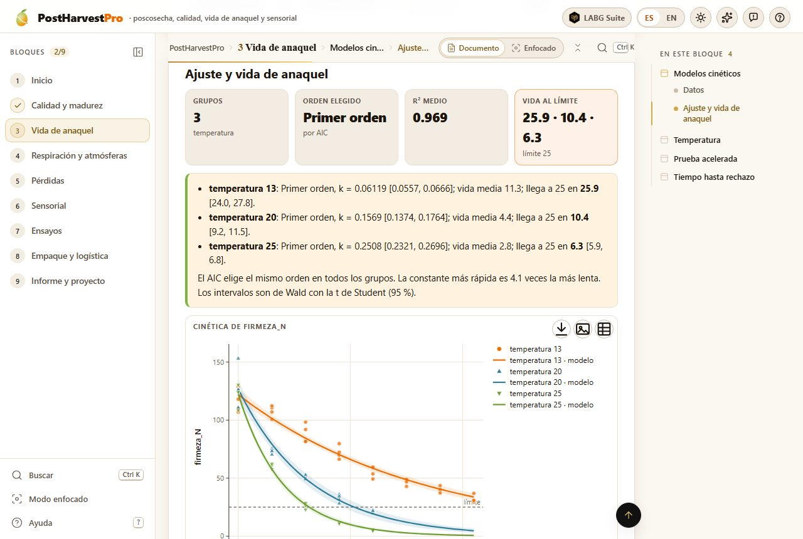

**Llevar las k al análisis de temperatura** copia las constantes a la pestaña siguiente cuando el grupo es la temperatura.

### 3.2 Temperatura

Con las constantes a varias temperaturas, la app ajusta tres modelos:

- **Arrhenius:** ln k = ln k_ref − (Eₐ/R)(1/T − 1/T_ref), por mínimos cuadrados sobre ln k (ponderados por el error estándar de k si lo tienes). Da Eₐ con su intervalo y k a cualquier temperatura.
- **Q10:** entre pares de temperaturas, (k₂/k₁)^(10/(T₂−T₁)), y desde Eₐ, Q10(T) = exp(10·Eₐ/(R·T·(T+10))). El Q10 no es constante: con la misma Eₐ es mayor a temperaturas bajas.
- **Raíz cuadrada** (Ratkowsky et al. 1982): √k = b(T − Tmín), con la temperatura mínima biológica y su intervalo.

**Vida de anaquel a cualquier temperatura:** con el orden, C₀ y el límite, la app calcula la vida a la temperatura del almacén. El intervalo puede ser el de la media o el de predicción, y se dibuja la curva de vida contra temperatura. Fuera de las temperaturas medidas, la app avisa que extrapola.

**Ejemplo.** Las k del mango dan Eₐ ≈ 84 kJ/mol, Q10 de 3.8 entre 13 y 20 °C y de 2.6 entre 20 y 25 °C, y Tmín ≈ 1.3 °C.

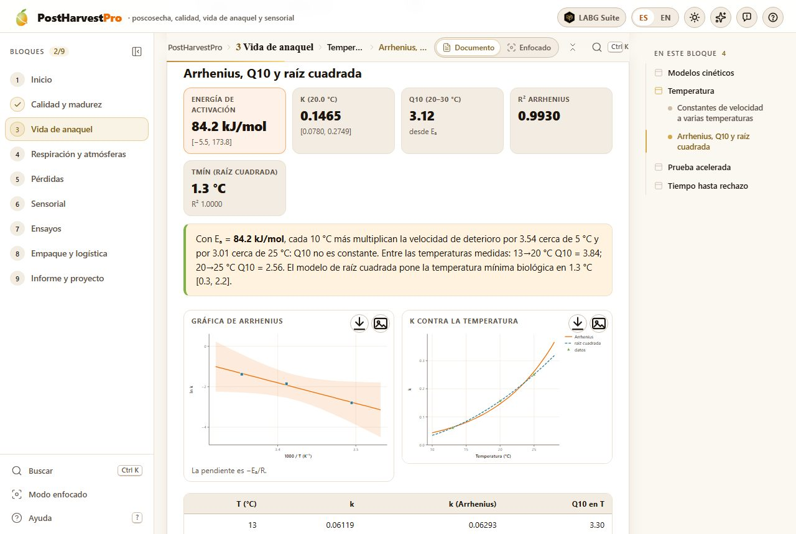

### 3.3 Prueba acelerada

Se escriben las vidas de anaquel observadas a temperaturas altas y la temperatura de almacén. La app ajusta una recta de ln θ contra 1/T (Arrhenius) o contra T (Q10). Da la vida estimada con su **intervalo de predicción**, que es el que corresponde a una nueva prueba y casi siempre es ancho. La predicción supone que el mecanismo de deterioro no cambia entre las temperaturas altas y la del almacén (Mizrahi 2004).

### 3.4 Tiempo hasta el rechazo

**Datos.** Una fila por fruto con:

- el **tiempo** hasta el rechazo, o hasta el último día que se vio sano;
- el **estado**: 1 si se rechazó, 0 si seguía aceptable al terminar (censurado);
- opcionalmente, el tratamiento.

Los frutos censurados **no se descartan**: aportan información mientras estuvieron en observación.

**Resultados:**

- **Kaplan–Meier** por tratamiento, con intervalos de Greenwood (logarítmico, log-log o lineal), la mediana con su intervalo y la media restringida;
- la prueba de **rango logarítmico**;
- los modelos **Weibull, log-normal, log-logístico y exponencial** con censura, comparados por AIC;
- el **tiempo en que se rechaza el porcentaje tolerado** (por ejemplo, el 10 %) y la mediana, con sus intervalos;
- las **razones de tiempos** de cada tratamiento contra el de referencia: 1.4 significa una vida 40 % más larga.

**Ejemplo (chayote).** El modelo de Weibull es el de menor AIC. El 10 % se rechaza hacia el día 8.4 [6.6, 10.7] en el testigo, 11.7 con cera vegetal y 14.0 con quitosano. Las curvas difieren (rango logarítmico χ² = 22.5, p < 0.001).

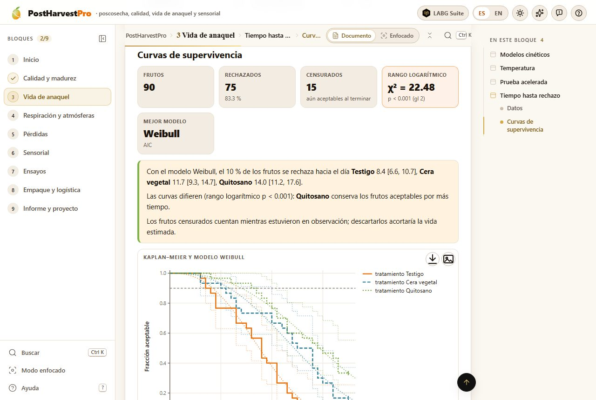

---

## 4. Respiración, etileno y atmósferas

### 4.1 Sistema estático

El producto se cierra en un frasco y se leen CO₂ (y, si se tienen, O₂ y etileno) a varios tiempos.

**Datos:**

- tiempo (h), CO₂ (%) y, si se midieron, O₂ (%) y etileno (µL/L);
- frasco (opcional);
- masa y volumen del frasco, en columnas o escritos abajo, con la densidad del producto y la temperatura.

**Cálculo.** La tasa sale de la **pendiente** de cada gas contra el tiempo, por mínimos cuadrados, y del volumen libre del frasco (volumen − masa/densidad). Con Vm = R·T/P:

- r(mL kg⁻¹ h⁻¹) = pendiente(%/h)/100 · V_libre · 1000 / m;
- r(mg kg⁻¹ h⁻¹) = pendiente/100 · V_libre / Vm · 44.01 · 1000 / m;
- el consumo de O₂ es menos su pendiente;
- el etileno es pendiente(ppm/h)·V_libre/m;
- el cociente respiratorio es CR = CO₂/O₂;
- el **calor de respiración** es 10.67 J por mg de CO₂.

La app clasifica la respiración y el etileno con las clases de Kader (2002), definidas a 5 °C y a 20 °C, respectivamente. Avisa si alguna recta tiene R² < 0.95 (fugas o lecturas atípicas).

**Ejemplo (aguacate a 20 °C).** 59.4 mg CO₂ kg⁻¹ h⁻¹, CR = 0.93, unos 176 W por tonelada.

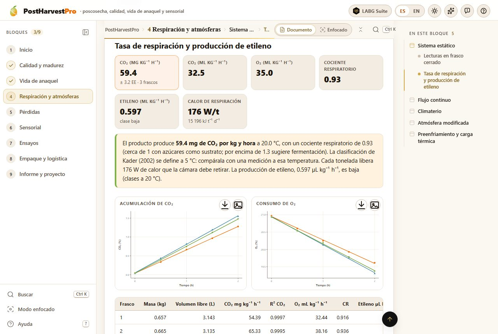

### 4.2 Flujo continuo

Para cada cámara se escriben la masa, el flujo de aire y las concentraciones a la entrada y la salida en estado estable. La tasa es Δ%/100 · F/m, con el mismo cálculo de CR, etileno y calor.

### 4.3 Climaterio

Con la respiración y el etileno de los mismos frutos durante la maduración, la app aplica una regla explícita:

- hay **alza respiratoria** si el pico, después de un mínimo previo, lo supera al menos 1.5 veces y no es la última lectura;
- hay **estallido de etileno** si su pico supera 10 veces su mínimo previo o llega a 1 µL kg⁻¹ h⁻¹.

Climatérico = ambos; no climatérico = ninguno; en otro caso, el resultado es incierto. Los umbrales se pueden cambiar. Es una orientación, no un veredicto.

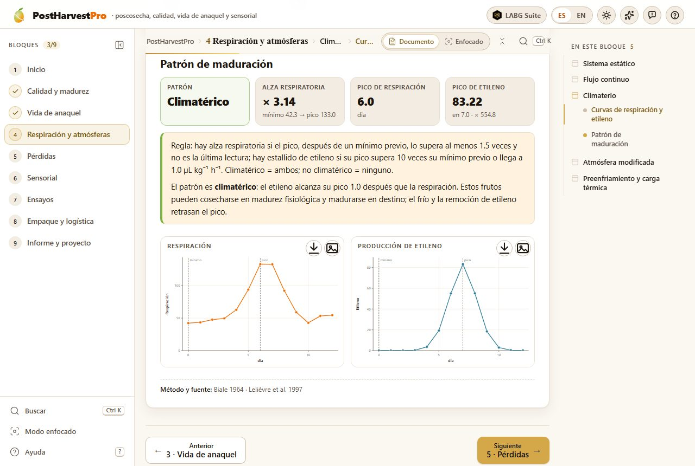

### 4.4 Atmósfera modificada

**Producto:** la ventana recomendada de O₂ y CO₂ (hay valores de Kader 2002 para varios cultivos), el consumo de O₂ a la temperatura del empaque, el cociente respiratorio y la masa.

**Empaque:** el largo y el ancho de la bolsa (dos caras), la película, su espesor y la temperatura.

**Estado estacionario** (Exama et al. 1993; Fishman et al. 1996): el O₂ que consume el producto iguala al que entra por la película, y lo mismo con el CO₂:

- O₂_dentro = O₂_fuera − 100·r_O₂·W·24·L/(P_O₂·A);
- CO₂_dentro = CO₂_fuera + 100·r_CO₂·W·24·L/(P_CO₂·A).

La permeabilidad P está en mL·µm m⁻² d⁻¹ atm⁻¹ y se corrige a la temperatura con su energía de activación. Si se marca, la respiración depende del O₂ según Michaelis–Menten con inhibición por CO₂ (Lee et al. 1991).

**Resultados:**

- la atmósfera de equilibrio y si cae dentro de la ventana;
- el riesgo de anaerobiosis (O₂ < 1 %);
- para cada película, el **espesor que lleva el O₂ al centro de la ventana** y el CO₂ resultante (un espesor fuera de 8–150 µm se marca como no fabricable);
- el plano O₂–CO₂, donde cada película traza una recta de pendiente CR/β, con β = P_CO₂/P_O₂. Si la ventana del producto no toca la recta de una película, ningún espesor de esa película la alcanza.

Las **permeabilidades de la tabla son orientativas** (Mangaraj et al. 2009): usa las de la ficha técnica de tu película.

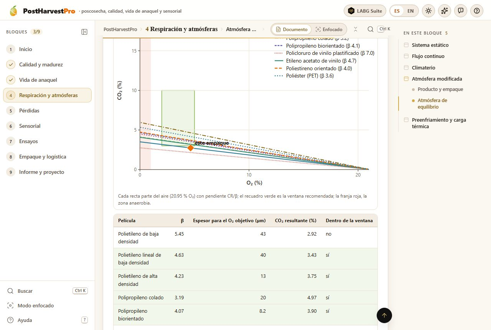

### 4.5 Preenfriamiento y carga térmica

- **Curva de enfriamiento.** Con la temperatura de la pulpa en el tiempo y la del medio se ajusta Y = (T − Tm)/(Ti − Tm) = j·e^(−C·t). De ahí salen el **tiempo de medio enfriamiento** ln(2j)/C, el de **siete octavos** ln(8j)/C y el tiempo para llegar a la temperatura objetivo (Thompson et al. 2008).
- **Carga de refrigeración.** Suma cuatro términos:
  - el calor de campo, m·cp·ΔT, con cp de Siebel = 0.0335·agua(%) + 0.837 kJ kg⁻¹ K⁻¹;
  - el calor del empaque;
  - el calor de respiración durante el enfriamiento;
  - un porcentaje para otras cargas (infiltración, ventiladores, luces, personas).

  El resultado se da en kW y en toneladas de refrigeración.

---

## 5. Pérdidas y cadena de valor

### 5.1 Pérdidas por etapa

Se escriben las etapas en orden, con su pérdida (en % de lo que **entra** a la etapa, o en kg) y el precio del kilo en ella, más la cantidad inicial. Como lo perdido en una etapa no llega a la siguiente, las pérdidas se acumulan. La app calcula:

- la cantidad que llega al final y el **índice de pérdidas** (% del total inicial);
- el **valor perdido** al precio de cada etapa y al precio final;
- el **diagrama de Sankey** de la cadena;
- las barras de pérdida en kg y en valor;
- los **puntos críticos**: las etapas que juntas suman el 80 % de la pérdida (Pareto), en cantidad y en valor.

**Enviar a EconomicsPro** descarga la tabla de la cadena en CSV y abre EconomicsPro para el análisis económico.

**Ejemplo (jitomate).** De cada 100 kg llegan 71.4. La etapa que más kilos pierde es la selección y empaque; la que más valor pierde es la venta al menudeo, porque ahí cada kilo ya vale más.

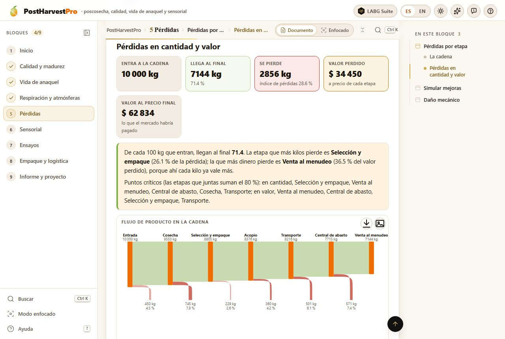

### 5.2 Simular mejoras

Al elegir una etapa y la reducción relativa de su pérdida (50 % = perder la mitad de lo de hoy), la app da los kilos que llegan además al final, su valor al precio final y el nuevo índice. La gráfica compara la misma reducción en cada etapa, para ver dónde rinde más el esfuerzo.

### 5.3 Daño mecánico

**Datos.** Una fila por fruto con la altura de caída (o la energía, o la fuerza) y el tamaño del daño. Son opcionales la incidencia (dañado 0/1) y la masa del fruto, con la que se calcula la energía E = m·g·h.

**Resultados:**

- las curvas lineal, cuadrática, de potencia y exponencial, comparadas por AIC;
- el **umbral de daño**: la altura en que la recta cruza el cero;
- la **susceptibilidad**: volumen de daño por joule (Bajema y Hyde 1998);
- con la incidencia, la **regresión logística** y las alturas que dañan al 50 % y al 10 % de los frutos, con el **intervalo de Fieller** (Finney 1971).

**Ejemplo.** La mitad de los jitomates se daña a 26.9 cm [21.5, 32.1] y el 10 % a 15.3 cm: en la línea de empaque, las caídas deben quedar por debajo de esa altura.

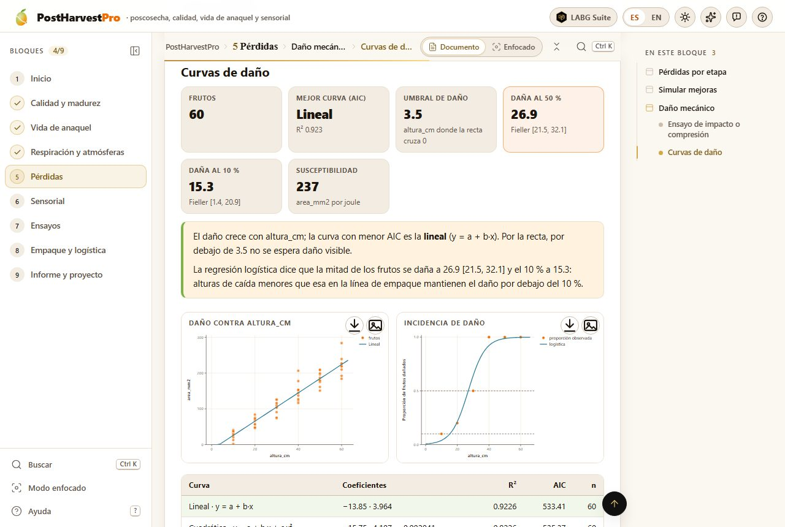

---

## 6. Evaluación sensorial

### 6.1 Discriminativas

En una tabla se escribe, para cada prueba, el método (triangular, dúo-trío, 2-AFC, 3-AFC o tétrada), los aciertos y el total de jueces. La prueba puede ser de **diferencia** o de **similitud**; esta última exige la proporción máxima de discriminadores que se considera despreciable, pd₀. Para cada prueba se obtienen:

- la proporción de aciertos pc y la de **discriminadores** pd, con sus intervalos;
- el **d′ de Thurstone**, que mide el tamaño de la diferencia en una escala común a todos los métodos, con su intervalo;
- el valor p (binomial exacto, de razón de verosimilitudes, de puntuación o de Wald);
- el número mínimo de aciertos para concluir.

**Planear.** Con el método, el d′ que se quiere detectar, α y la potencia deseada, la app da el **número de jueces** y compara los cinco métodos. Muestra las funciones psicométricas y la potencia contra el número de jueces. La potencia exacta sube en dientes de sierra: un juez más no siempre la aumenta.

También están la prueba **A–no A** (d′ = z(aciertos) − z(falsas alarmas)) y la **preferencia pareada** (binomial bilateral; los «sin preferencia» se excluyen o se reparten).

**Ejemplo.** En la triangular, 21 de 42 aciertos: las muestras se distinguen (p = 0.019), con d′ = 1.47 [0.31, 2.28].

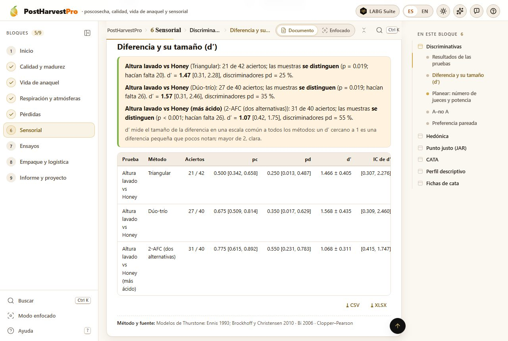

### 6.2 Hedónica

**Datos:** consumidor, producto y agrado (escala de 9 puntos).

**Resultados:**

- el ANOVA de dos vías (producto + consumidor) y las medias con error estándar;
- las **letras de Tukey**;
- la lectura de cada media en palabras de la escala;
- como alternativa no paramétrica, **Friedman** sobre los rangos de cada consumidor.

Si el diseño es desbalanceado (no todos probaron todo), el efecto de producto se ajusta por consumidor.

### 6.3 Punto justo (JAR) y penalidades

**Datos:** consumidor, producto, agrado y una columna por atributo en la escala de punto justo (3, 5, 7 o 9 niveles).

Para cada producto y atributo se calculan:

- los porcentajes de «muy poco», «justo» y «demasiado»;
- la **caída del agrado** de cada grupo fuera del punto justo respecto al grupo «justo», con su prueba t;
- la **penalidad ponderada** = caída × proporción de consumidores.

En la **gráfica de penalidades**, lo que conviene corregir primero queda arriba a la derecha: mucha gente y mucha caída. Por omisión se señalan los atributos con al menos 20 % de consumidores fuera del punto justo.

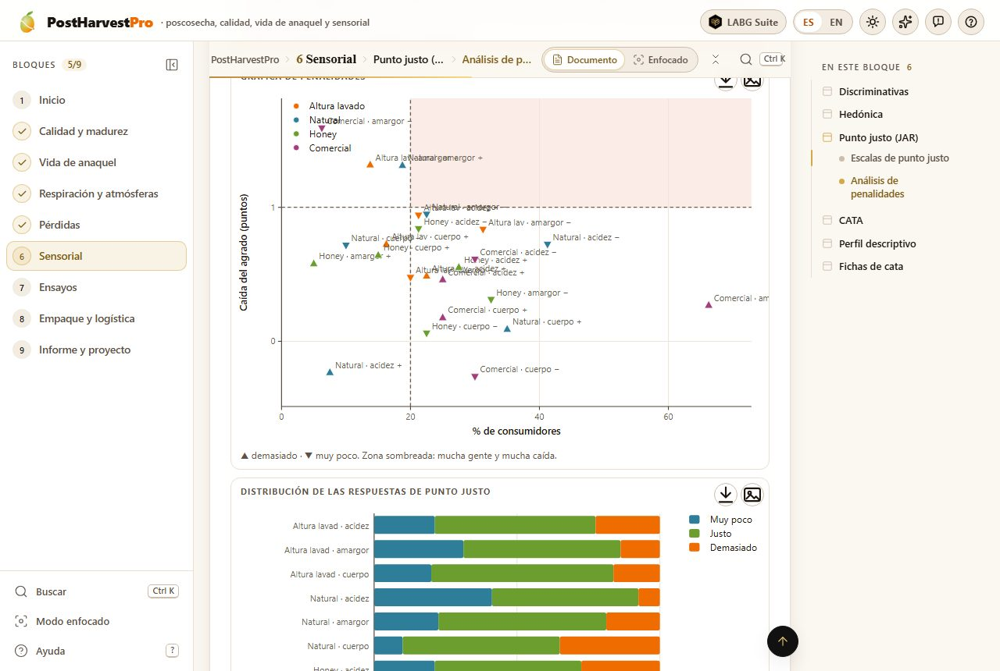

### 6.4 CATA

**Datos:** consumidor, producto y una columna 0/1 por término.

**Resultados:**

- la frecuencia de cada término por producto;
- la **Q de Cochran** por término (¿discrimina entre productos?);
- las comparaciones por pares con McNemar y ajuste de Holm;
- el **análisis de correspondencias** de la tabla de frecuencias: en el mapa, un producto cerca de un término se describe con él más que el promedio.

Sólo cuentan los consumidores que evaluaron todos los productos.

### 6.5 Perfil descriptivo

**Datos:** juez, producto, sesión o repetición (opcional) y los atributos.

**Para cada atributo:**

- el ANOVA producto + juez (+ sesión) + producto × juez;
- con repeticiones, el efecto de producto **se prueba contra la interacción**, de modo que la conclusión vale para el panel y no sólo para esos jueces;
- las medias con letras (LSD o Tukey) con el mismo error.

**Gráficas:** la **araña** y el **mapa de productos**, que es el ACP de las medias, con los atributos como flechas.

**Desempeño del panel.** Para cada juez se calculan tres cosas:

- **discriminación**: el ANOVA por producto con sus propias repeticiones;
- **repetibilidad**: su desviación residual;
- **acuerdo**: la correlación entre sus medias y las del panel.

Se señalan los jueces con p mediano mayor que 0.20, acuerdo menor que 0.5 o repetibilidad peor que 1.5 veces la mediana del panel. Con pocas repeticiones, el ANOVA de un solo juez tiene poca potencia; por eso los umbrales son permisivos.

**Enviar a PCAPro** descarga las medias producto × atributo para un mapa de preferencias externo en PCAPro.

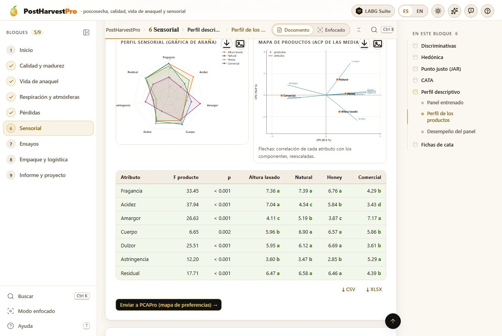

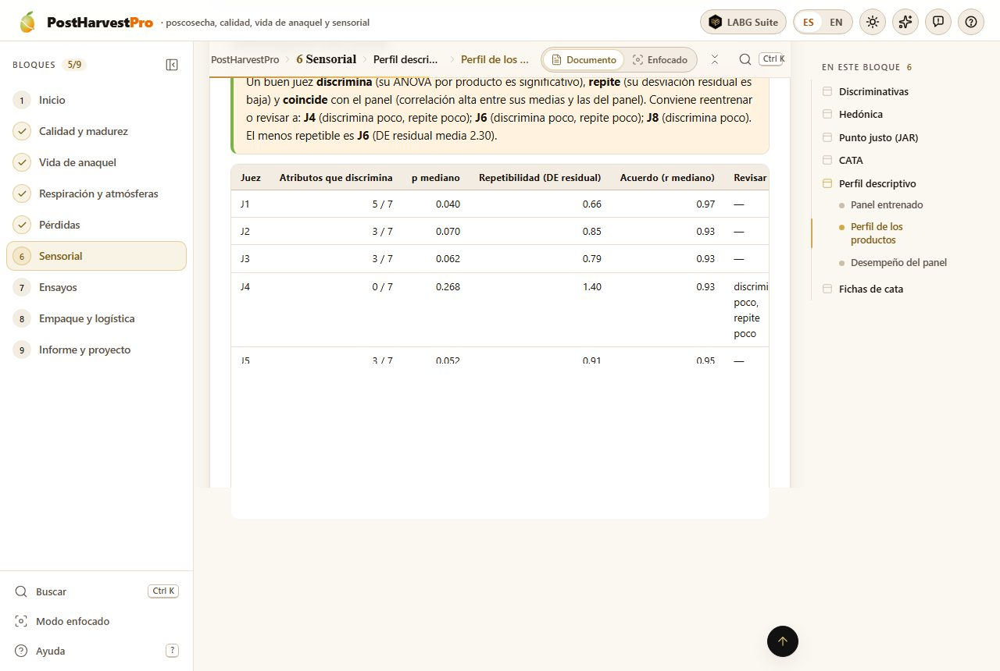

### 6.6 Fichas de cata

Con los productos, el número de jueces y una semilla, la app genera:

- los **órdenes de presentación de Williams**, balanceados por posición y por arrastre de primer orden (un cuadrado si el número de productos es par, dos si es impar);
- **códigos de tres dígitos al azar**, uno por producto, o uno distinto para cada juez.

El plan de servicio se descarga en CSV, y las **fichas** (hedónica de 9 puntos, perfil con escalas de línea o triangular) se imprimen. Para un balance completo, el número de jueces debe ser múltiplo del número de órdenes.

---

## 7. Ensayos poscosecha

### 7.1 Factorial tratamiento × tiempo

Se usa cuando cada tiempo de muestreo usa frutos distintos (muestreo destructivo). Los datos son la respuesta, el tratamiento, el tiempo y el bloque (opcional).

- La app ajusta el factorial completamente al azar o en bloques, con sumas de cuadrados de tipo III (o I).
- Puede usar sólo los tiempos medidos en todos los tratamientos.
- Compara los tratamientos **dentro de cada tiempo** con Tukey–Kramer, LSD, Bonferroni o Dunnett contra el testigo, y asigna letras.
- Dibuja la evolución de cada tratamiento (media ± EE).

Si la interacción es significativa, el efecto del tratamiento cambia con el tiempo y no debe resumirse con sus promedios generales.

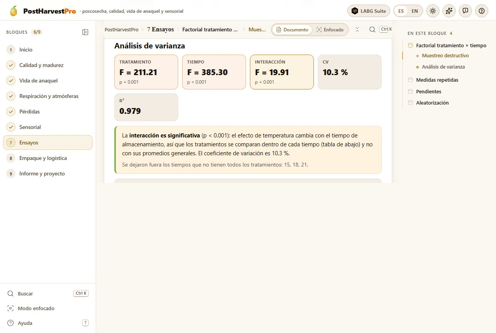

### 7.2 Medidas repetidas

Se usa cuando se miden los mismos frutos en cada tiempo (peso, color no destructivo). Los datos son la respuesta, el tratamiento, el tiempo, la **unidad** y el bloque (opcional).

- El análisis es de **parcelas divididas en el tiempo**: el tratamiento se prueba contra las unidades; el tiempo y la interacción, contra el error residual.
- La **prueba de Mauchly** revisa la esfericidad, y los valores p se corrigen con los épsilones de **Greenhouse–Geisser** y **Huynh–Feldt** (corrección de Lecoutre).
- Dentro de cada tiempo, los tratamientos se comparan con el error combinado de las dos estratas y los grados de libertad de Satterthwaite.
- Los tiempos en que todas las unidades valen lo mismo (el día 0 de la pérdida de peso) no aportan información y se dejan fuera, con aviso.

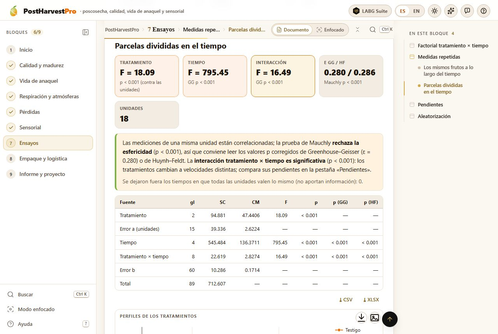

### 7.3 Pendientes

Para cada tratamiento se ajusta una recta del atributo contra el tiempo. La app prueba si las **pendientes son iguales** (análisis de covarianza) y, con pendiente común, si los niveles difieren. Las pendientes se comparan por pares con ajuste de Holm. Si las mismas unidades se midieron en cada tiempo, estas pruebas son optimistas: la referencia es la de medidas repetidas.

**Ejemplo (chayote).** El testigo pierde peso 1.5 veces más rápido que la cera vegetal.

### 7.4 Aleatorización

A partir de los tratamientos, los tiempos de muestreo, las repeticiones, el diseño (al azar o en bloques), el tipo de muestreo (destructivo o repetido) y una semilla, la app genera el **libro de campo** con la asignación al azar y columnas vacías para las variables. Se descarga en CSV o XLSX. Sus columnas (Parcela, Bloque o Repetición, Tratamiento, Tiempo) son las que reconoce el bloque de datos de AgriDesign, el programa de diseño experimental de la suite.

---

## 8. Empaque y logística

### 8.1 Tarima y contenedor

Con las medidas de la tarima (ISO 120 × 100, europea 120 × 80, norteamericana 48 × 40 u otra) y de la caja, la app busca el mejor acomodo por cama. Prueba patrones de uno y dos bloques con orientaciones distintas (Steudel 1979; Smith y De Cani 1980) y calcula:

- las camas que caben bajo la altura máxima y el peso máximo;
- las cajas por tarima y el área aprovechada;
- las tarimas por contenedor (refrigerado de 20 o 40 pies, o caja de 53 pies), con estiba opcional.

Las medidas de los contenedores son orientativas: verifica la ficha del transportista.

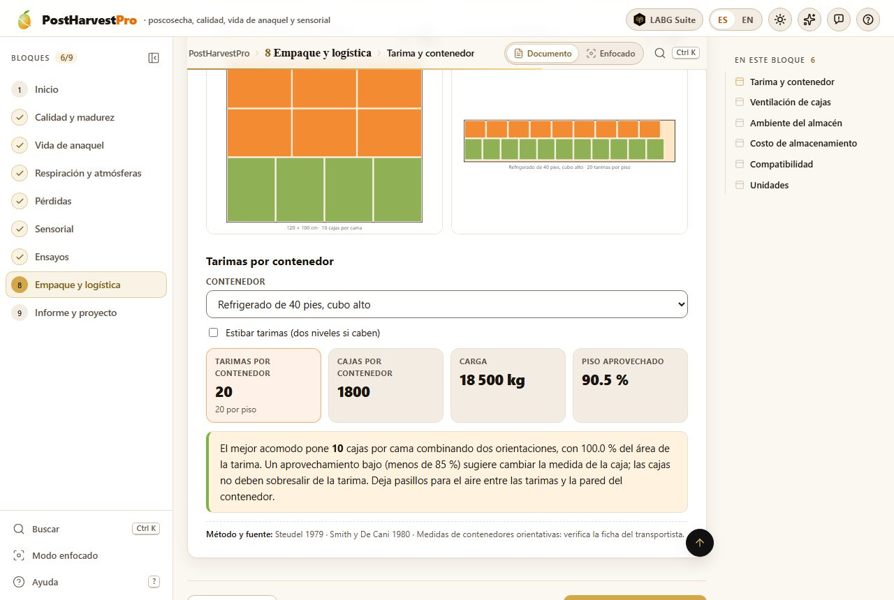

### 8.2 Ventilación de cajas

Con las medidas de las caras y los orificios (ranuras redondeadas, rectángulos o círculos), la app calcula el **porcentaje de área abierta** de cada cara. Para el enfriamiento con aire forzado conviene al menos 5 %; por encima de 8 % la caja pierde resistencia.

### 8.3 Ambiente del almacén

**Datos:** temperatura y humedad del aire, altitud (de ella sale la presión) y temperatura del producto.

**Resultados:**

- la humedad absoluta, la razón de humedad, el punto de rocío, el bulbo húmedo, la entalpía y el volumen específico (ASHRAE 2017);
- la presión de saturación, con las ecuaciones de Wagner y Pruss (2002) sobre agua y de Wagner et al. (2011) sobre hielo;
- el **déficit de presión de vapor** del aire y el **déficit entre el producto y el aire**, que es el que impulsa la pérdida de agua;
- la **pérdida de agua** por día y por semana, con el coeficiente de transpiración del producto (Sastry et al. 1978; editable);
- la **carta psicrométrica** con el punto de la cámara y el del aire exterior.

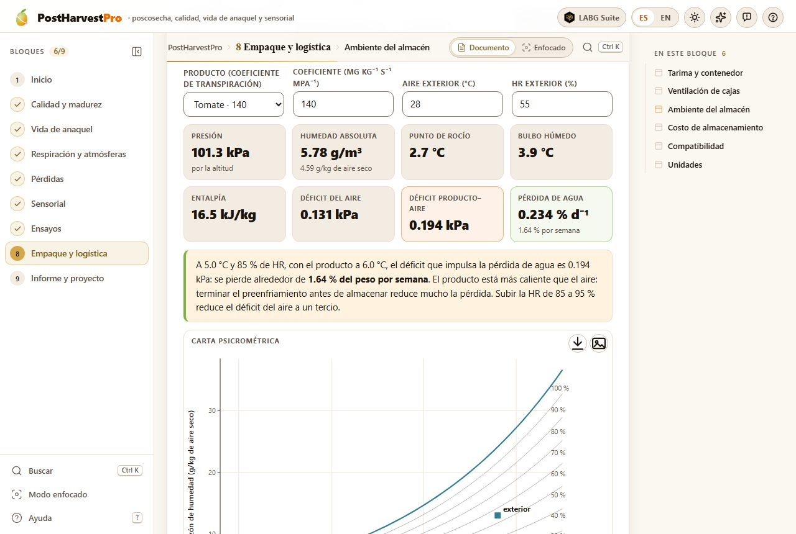

### 8.4 Costo de almacenamiento

Con la energía, la tarifa, la mano de obra, otros gastos, la depreciación y renta anuales, la capacidad, la ocupación y la merma diaria, la app da el costo por día de la cámara y por tarima. Almacenar sólo conviene si el precio esperado sube más que eso por cada día de espera.

### 8.5 Compatibilidad

Elige los productos que piensas almacenar o transportar juntos. La app revisa cuatro cosas por par:

- **temperaturas** que no se traslapan (una protege a un producto y daña al otro por frío);
- **humedades** distintas;
- un **productor de etileno** junto a un producto **sensible** a él;
- **olores** que pasan de un producto a otro.

Da la temperatura y la humedad comunes, si existen, y una matriz de pares. Los valores de la tabla son orientativos y editables (Kader 2002; Gross et al. 2016; McGregor 1989).

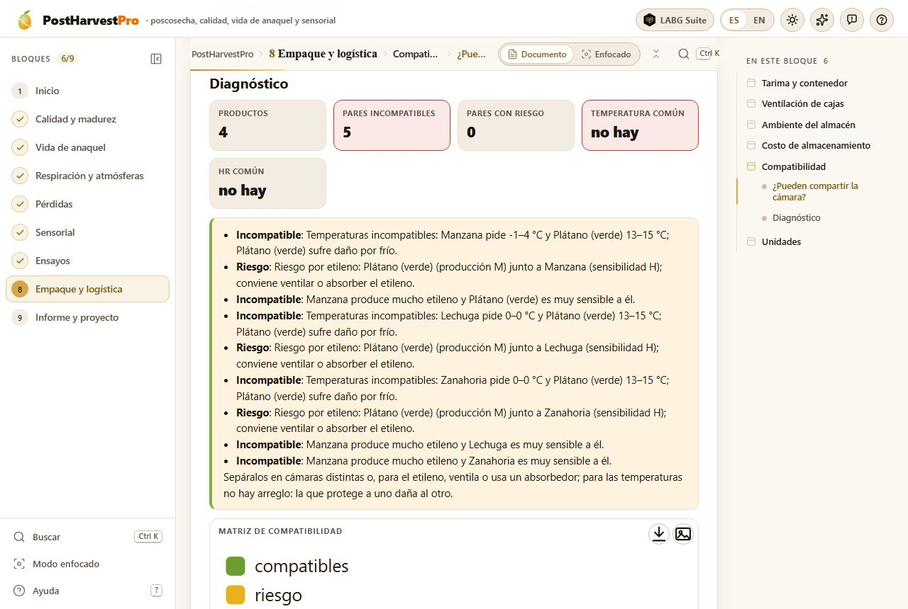

### 8.6 Unidades

Convierte temperatura, presión, masa, fuerza (firmeza), longitud (espesor de películas en µm o mil) y concentración de gases (%, ppm, ppb).

---

## 9. Informe y proyecto

### 9.1 El informe

Escribe el título, el responsable, el producto, la fecha y unas notas, y elige las secciones (cada análisis que corriste deja la suya). **Generar el informe** arma un solo archivo HTML con:

- una portada y un resumen con índice;
- cada sección con sus gráficas (SVG con los colores del tema claro), sus tablas y su lectura en palabras;
- las **recomendaciones de manejo poscosecha**;
- los **métodos y referencias** de los bloques usados, y cómo citar.

El informe se ve en la página, se descarga y se imprime a PDF desde el navegador.

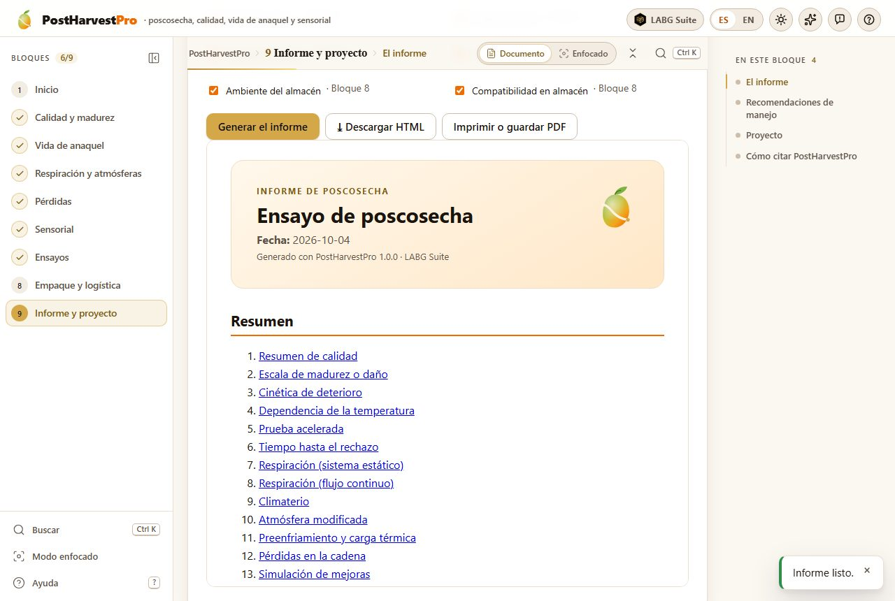

### 9.2 Recomendaciones de manejo

Salen de tus resultados con reglas explícitas, por ejemplo:

- vender antes del tiempo al límite de calidad;
- mantener la cadena de frío según Eₐ;
- cosechar en madurez fisiológica los productos climatéricos;
- ajustar el empaque si la atmósfera no llega a la ventana;
- invertir en la etapa que más valor pierde;
- limitar las alturas de caída;
- subir la humedad si la pérdida de agua pasa de 2 % por semana;
- separar los productos incompatibles.

Revísalas con tu criterio.

### 9.3 El proyecto

**Guardar proyecto** descarga un archivo JSON con las tablas que cargaste, las columnas que elegiste, las tablas editadas y los ajustes. **Abrir proyecto** lo carga y recalcula todo. El archivo se queda en tu equipo.

---

## Apéndice A. Fórmulas principales

| Tema | Fórmula |
|---|---|
| SST/AT, BrimA | SST/AT; SST − 2·AT |
| Acidez titulable | V·N·meq·(aforo/alícuota)·100/muestra |
| Croma y tono | C\* = √(a\*² + b\*²); h° = atan2(b\*, a\*) |
| ΔE\*ab | √(ΔL\*² + Δa\*² + Δb\*²) |
| Índice de McKinney | 100·Σ(clase·n)/(N·clase máx.) |
| Cinética | C₀ − kt; C₀e^(−kt); 1/C = 1/C₀ + kt |
| Arrhenius | ln k = ln A − Eₐ/(RT) |
| Q10 | (k₂/k₁)^(10/(T₂ − T₁)); exp(10Eₐ/(RT(T + 10))) |
| Raíz cuadrada | √k = b(T − Tmín) |
| Kaplan–Meier | Ŝ(t) = Π(1 − dᵢ/nᵢ); Var[log Ŝ] = Σ dᵢ/(nᵢ(nᵢ − dᵢ)) |
| Respiración (estático) | pendiente/100·V_libre/Vm·M·1000/m |
| Atmósfera de equilibrio | O₂_in = O₂_out − 100·r·W·24·L/(P·A) |
| Enfriamiento | Y = j·e^(−Ct); ½: ln(2j)/C; ⅞: ln(8j)/C |
| Calor de campo | m·cp·ΔT; cp = 0.0335·agua + 0.837 |
| d′ triangular | Pc = 2∫₀^∞ {Φ[−z√3 + d√(2/3)] + Φ[−z√3 − d√(2/3)]} φ(z) dz |
| Penalidad JAR | (ȳ_justo − ȳ_grupo) · % del grupo |
| Q de Cochran | (k − 1)[kΣC² − N²]/(kN − ΣR²) |
| Greenhouse–Geisser | ε = (Σλ)²/((b − 1)Σλ²) |
| Déficit de vapor | p_ws(T_producto) − HR·p_ws(T_aire) |

## Apéndice B. Referencias

Las 78 referencias de los métodos están en la portada de la app (sección «Referencias») y en `js/refs.js`. El informe incluye las que corresponden a los bloques que usaste.

## Apéndice C. Cómo citar

Barrera-Guzmán, L. Á. (2026). *PostHarvestPro: fisiología y tecnología poscosecha, calidad, vida de anaquel y evaluación sensorial en el navegador* (versión 1.0.0) [Programa de cómputo]. https://luisangelbg.github.io/PostHarvestPro/

```
@software{barreraguzman2026postharvestpro,
  author  = {Barrera-Guzmán, Luis Ángel},
  title   = {PostHarvestPro: postharvest physiology and technology, quality, shelf life and sensory evaluation in the browser},
  version = {1.0.0},
  year    = {2026},
  license = {GPL-3.0-or-later},
  url     = {https://luisangelbg.github.io/PostHarvestPro/}
}
```
